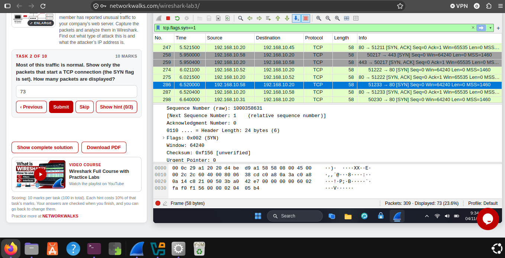
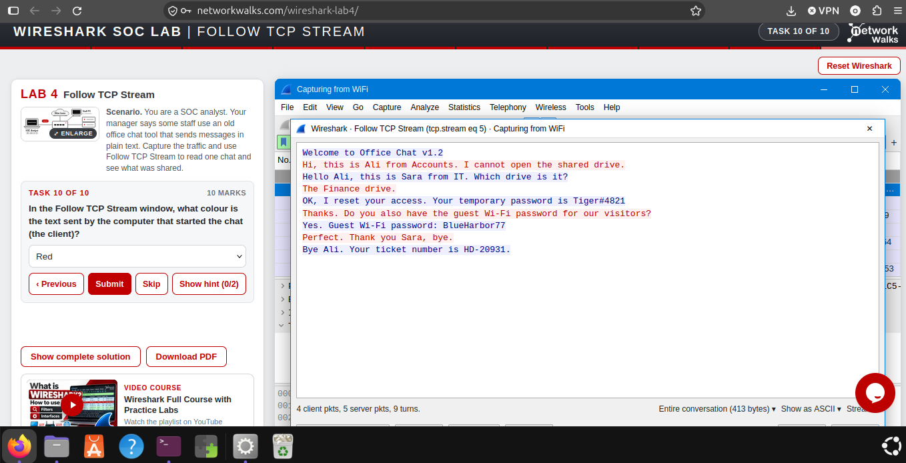
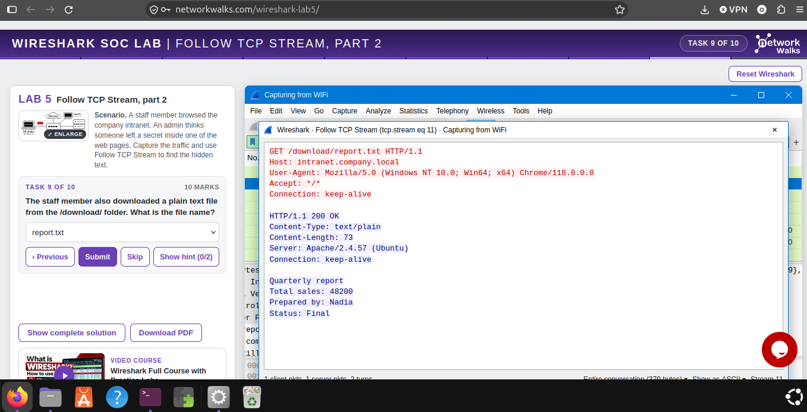
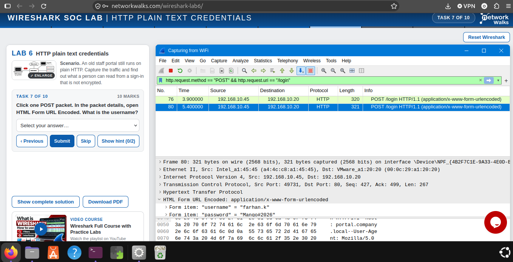
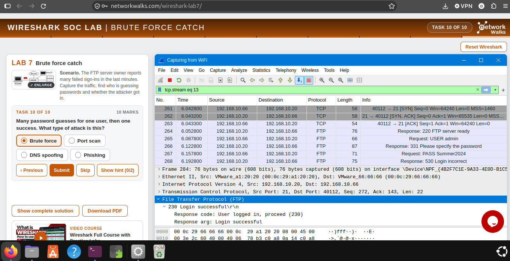
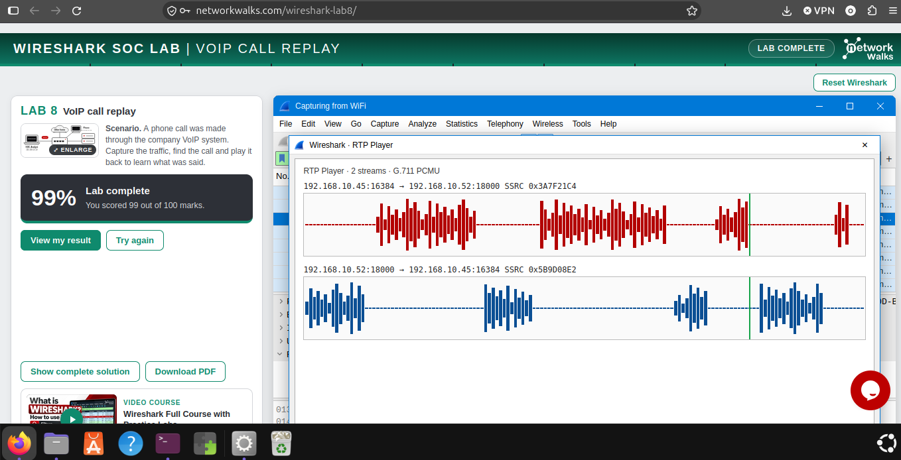

# Networkwalks – Wireshark SOC Labs

## Overview

This repository documents six hands-on Security Operations Centre (SOC) investigation labs completed using Wireshark as part of my Networkwalks Cybersecurity Internship.

The exercises focused on analysing captured network traffic, identifying suspicious IP addresses, reconstructing TCP conversations, investigating exposed credentials, detecting brute-force activity, and analysing VoIP communication.

## Tools and Technologies

- Wireshark
- Ubuntu Linux
- TCP/IP
- HTTP
- FTP
- SIP
- RTP

---

## LAB 01: Identify the Attacker's IP

### Objective
Investigate captured network traffic to identify a suspicious IP address responsible for unusual activity.

### Investigation
- Examined source and destination IP addresses.
- Analysed packet communication patterns.
- Used Wireshark filters to isolate suspicious traffic.
- Investigated traffic sources to identify the suspected attacker.

### Key Learning
Network packet analysis helps security analysts identify suspicious hosts and investigate potential network attacks.

### Evidence

---

## LAB 02: Follow TCP Stream – Part 1

### Objective
Reconstruct a TCP conversation to understand the information exchanged between communicating hosts.

### Investigation
- Inspected TCP packets.
- Used the Follow TCP Stream feature.
- Reconstructed client-server communication.
- Examined transmitted application data.

### Key Learning
TCP stream reconstruction allows analysts to inspect conversations and discover information that may not be immediately visible in individual packets.

### Evidence

---

## LAB 03: Follow TCP Stream – Part 2

### Objective
Continue investigating TCP communication and identify information exposed through captured network traffic.

### Investigation
- Analysed TCP conversations.
- Followed communication between hosts.
- Examined transmitted content.
- Investigated information contained within the reconstructed stream.

### Key Learning
Packet captures provide valuable evidence during network investigations and can reveal sensitive information transmitted between systems.

### Evidence

---

## LAB 04: HTTP Plain Text Credentials

### Objective
Investigate how sensitive login information can be exposed when transmitted over unencrypted HTTP.

### Investigation
- Applied HTTP display filters.
- Inspected HTTP POST requests.
- Examined request data.
- Investigated how credentials can appear in unencrypted communication.

### Key Learning
HTTP does not encrypt transmitted information. HTTPS, which uses TLS, protects sensitive information while it travels across the network.

### Evidence

---

## LAB 05: Catch the Brute Force Attacker

### Objective
Investigate repeated authentication attempts and identify suspicious activity associated with a potential brute-force attack.

### Investigation
- Examined authentication-related traffic.
- Investigated repeated login attempts.
- Inspected FTP commands and server responses.
- Analysed source IP addresses associated with suspicious requests.

### Key Learning
Repeated login attempts can indicate password-guessing attacks. Monitoring authentication traffic helps security analysts detect suspicious login behaviour.

### Evidence

---

## LAB 06: Catch the Call Scammer

### Objective
Investigate VoIP communication by analysing SIP signalling and RTP voice traffic.

### Investigation
- Examined SIP signalling messages.
- Investigated call setup information.
- Analysed RTP packets.
- Identified the audio codec used in the communication.
- Explored the security risks of unencrypted voice traffic.

### Key Learning
Unencrypted RTP traffic can expose private voice conversations. Secure Real-time Transport Protocol (SRTP) provides encryption to protect voice communication.

### Evidence

---

## Skills Developed

- Network traffic analysis
- Packet inspection
- TCP stream reconstruction
- IP address investigation
- HTTP security analysis
- Authentication traffic investigation
- Brute-force attack detection
- SIP and RTP analysis
- VoIP security fundamentals
- Wireshark display filtering

## Conclusion

Completing these six practical labs strengthened my understanding of network traffic analysis and introductory SOC investigation techniques.

The exercises provided practical exposure to identifying suspicious network behaviour, investigating communication protocols, and understanding how sensitive information can be exposed through insecure network communication.

This project represents part of my continuous hands-on development in networking and cybersecurity.

**Programme:** Networkwalks Cybersecurity Internship  
**Module:** Wireshark SOC Labs  
**Platform:** Ubuntu Linux  
**Primary Tool:** Wireshark

*All investigations were performed in authorised training lab environments.*
